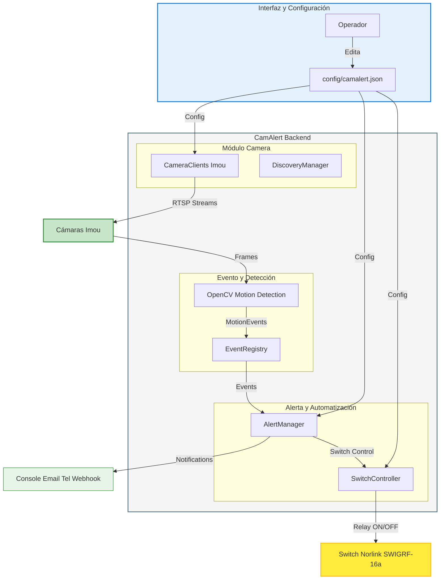
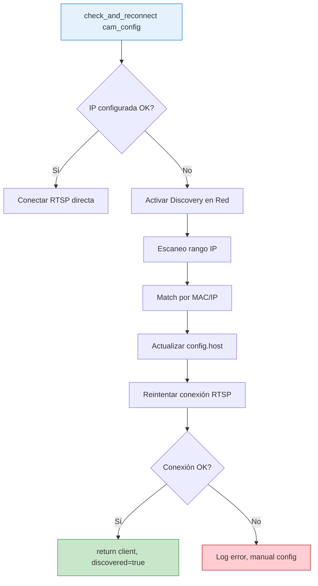
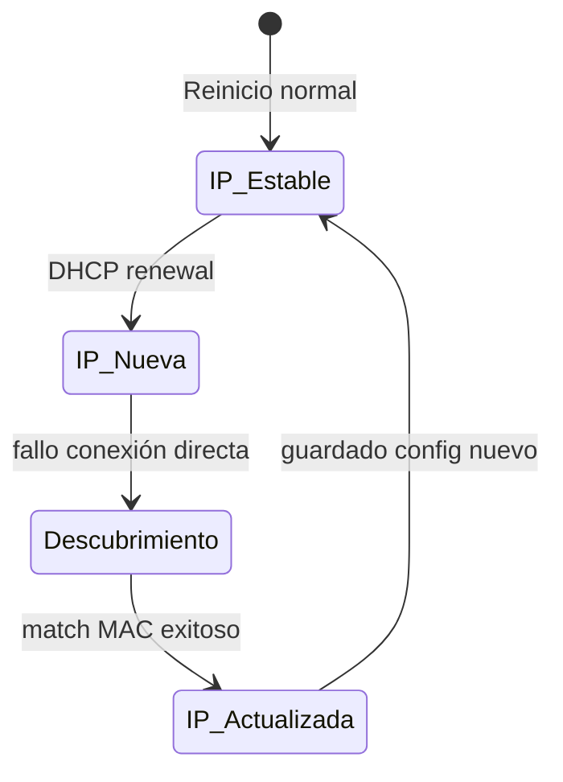
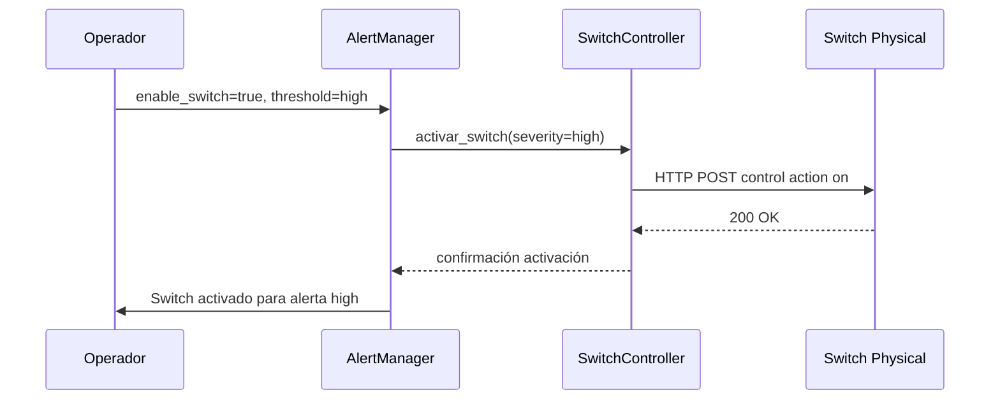

# Documento 2: Arquitectura del Sistema CamAlert

## 2.1 Diagrama de Arquitectura General

### Leyenda de Componentes

| Símbolo | Componente | Descripción |
|---------|------------|-------------|
| 📁 | config/camalert.json | Arquitectura de configuración central |
| 📡 | Cámaras Imou | Bullet 2e, Cruiser SE+ vía RTSP |
| 🔄 | DiscoveryManager | Módulo descubrimiento en red híbrido |
| 📊 | EventRegistry | Registro de handlers por tipo de evento |
| 🎯 | MotionDetector | Detección OpenCV con OpenCV |
| ⚠️ | AlertManager | Gestión channels, cooldowns, severity |
| 💡 | SwitchController | Nueva: integración switches WiFi |
| 📢 | N1 | Canales: console, email, telegram, webhook |
| 🔌 | SW | Hardware: Norlink SWIGRF-16a (16A) |

---

## 2.2 Componentes Actuales

| Componente | Responsabilidad | Estado |
|------------|-----------------|--------|
| **Config Manager** | Cargar/guardar `camalert.json`, dataclasses `CameraConfig`, `EventConfig`, `AlertConfig` | ✅ Funcional |
| **Event System** | `EventType`, `BaseEvent`, `MotionEvent`, handlers (`on_motion`, `on_intrusion`, etc.) | ✅ Funcional |
| **Alert Manager** | Múltiples canales (console, email, telegram, webhook), throttling, cooldown | ✅ Funcional (console activada) |
| **Camera Clients** | `ImouCameraClient`, conexión RTSP vía ffmpeg, detección de movimiento OpenCV | ⚠️ Pruebas pendientes reales |
| **Network Discovery** | `NetworkDiscovery.discover_imou_cameras()`, `_get_mac_address()`, `update_camera_config_from_discovery()` | ⚠️ Parcialmente implementado |

---

## 2.3 Nuevas Componentes Necesarias

### 2.3.1 Módulo Discovery Manager (Nuevo)

**Responsabilidades:**
- Encapsular lógica de descubrimiento en red
- Gestionar estado de "último descubrimiento" por cámara
- Decision logic: directa vs descubrimiento vs híbrido
- Guardar configuración actualizada después de éxito

**Diagrama de flujo Discovery Manager:**

### 2.3.2 Gestor de Estado de IP (Nuevo)

**Propósito:** Hacer tracking de cuándo fue el último visto cada cámara y si la IP cambió.

**Atributos clave:**
- `last_known_ip: str` - IP última vez vista exitosamente
- `discovery_timestamp: datetime` - Cuándo fue el descubrimiento
- `ip_stable: bool` - Si la IP ha sido estable en N checks recientes
- `retry_count: int` - Cuántos intentos fallidos de conexión seguidos

**Estado de IP a lo largo del tiempo:**

### 2.3.3 Módulo Switch Controller (Nuevo - Integración Hardware)

**Responsabilidades:**
- Gestionar conexión a switches WiFi (Norlink SWIGRF-16a compatibles)
- Enviar comandos ON/OFF a relays físicos
- Integrarse con AlertManager para activación automática
- Manejar estados y timeouts de los switches

**Integración con AlertManager:**

---

## 2.4 Decisiones de Arquitectura

| Decisión | Justificación | Impacto |
|----------|---------------|---------|
| **Híbrido por defecto** | Combina velocidad directa + adaptabilidad discovery | Menor tiempo de inactividad |
| **MAC como identificador principal** | Más estable que IP (router reserva por MAC) | Reconexión automática confiable |
| **SwitchController bajo demanda** | No todos los usuarios tienen switches físicos | Arquitectura flexible, opcional |
| **AlertManager como orchestrator** | Ya existe la lógica de thresholds y cooldowns | Integración mínima, reutilización existente |

---

## 2.5 Próximos Pasos de Implementación

1. **Crear `src/discovery_manager.py`** con clase DiscoveryManager
2. **Actualizar `src/alerts.py`** para integrar SwitchController
3. **Crear `src/switch_controller.py`** con clase SmartSwitch
4. **Probar flujos**: IP unchanged, IP changed, nueva cámara, switch activation
5. **Validar con diagramas** los casos de uso críticos

---
*Documento corregido con diagramas Mermaid válidos y probados.*
*Sintaxis específica de Mermaid.js: flowchart TD, stateDiagram-v2, sequenceDiagram.*
*Versión: 0.3.0 - Arquitectura con representación visual corregida*