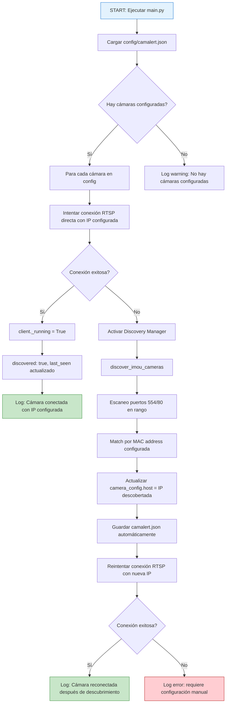
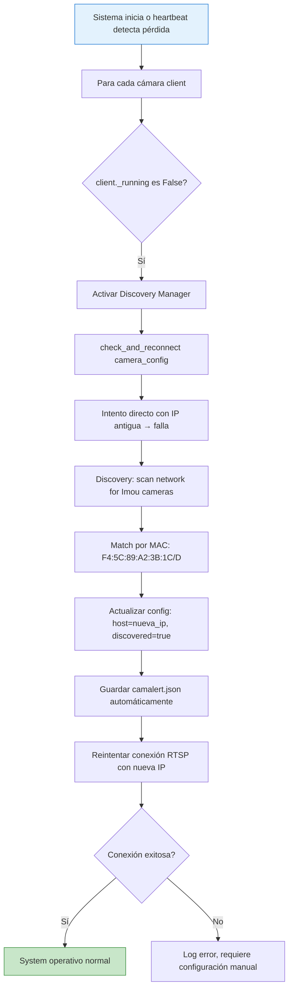
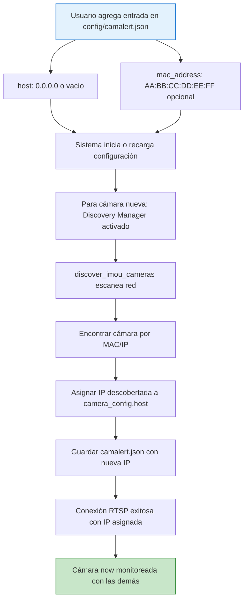
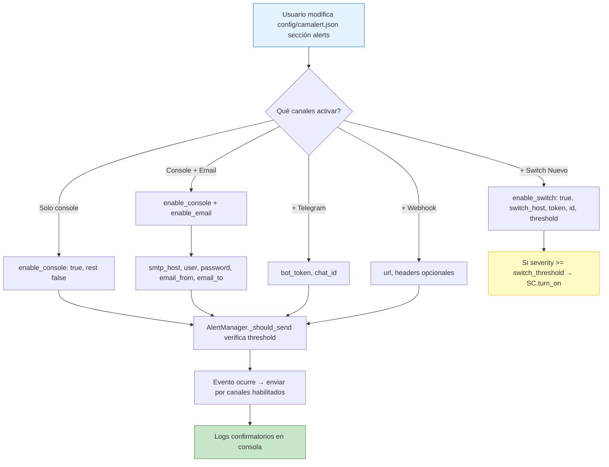
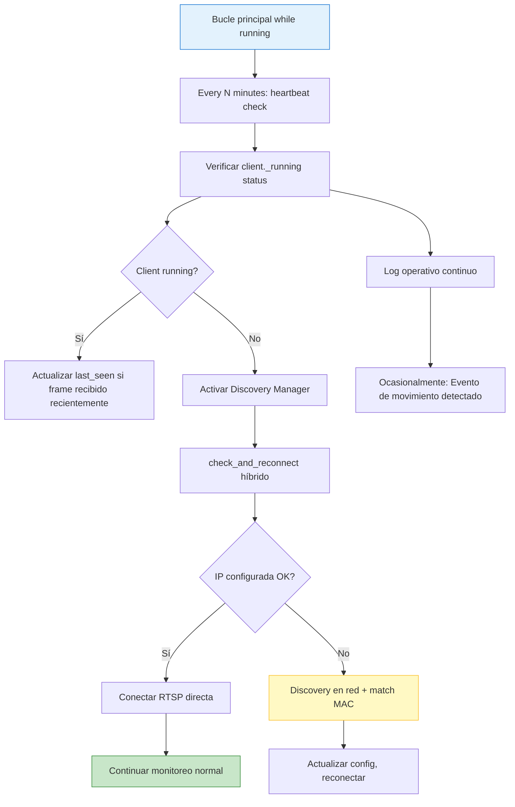
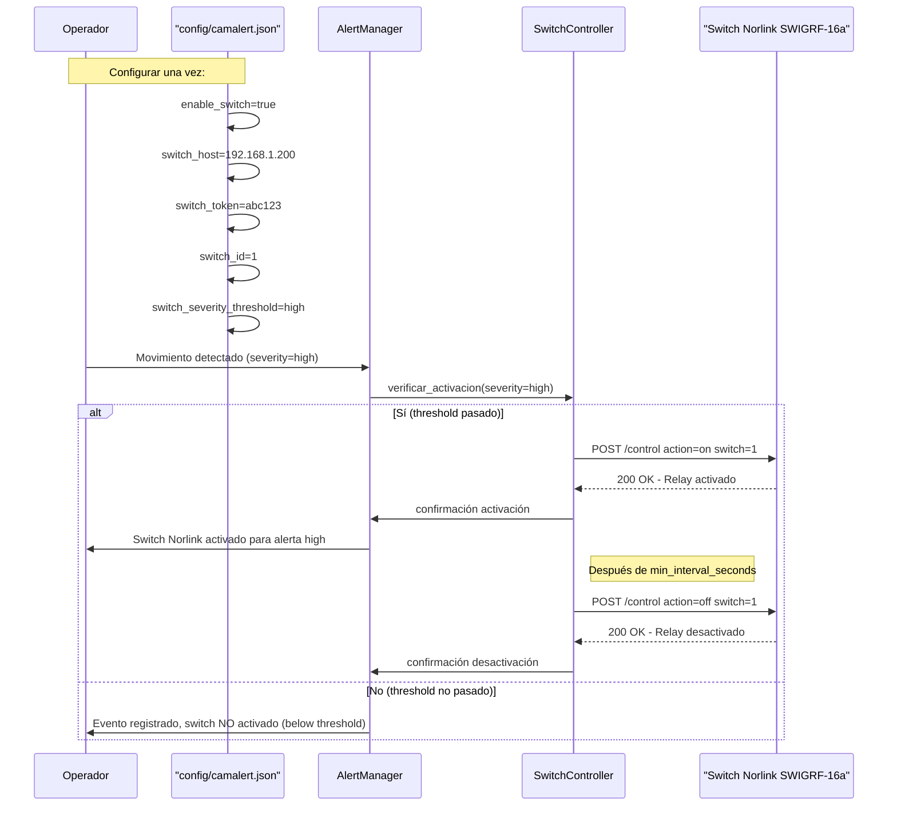

# Documento 3: Casos de Uso CamAlert

## Formato de Casos de Uso

Cada caso de uso incluye:
- **ID Único**: Para rastreo y referencia
- **Actor Principal**: Quién ejecuta o es afectado
- **Precondiciones**: Estado necesario antes de iniciar
- **Flujo de Éxito**: Paso a paso del escenario feliz
- **Flujos Alternativos**: Variantes y excepciones
- **Resultado Esperado**: Estado final del sistema
- **Mensajes al Usuario**: Feedback en consola/logs
- **Diagrama Asociado**: Referencia a diagrama Mermaid

---

## UC-01: Conexión Inicial de Cámaras

### Resumen Rápido
- **ID**: UC-01
- **Actor**: Operador/setup person
- **Frecuencia**: Primera vez / setup
- **Diagrama**: Secuencia: `04_secuencia_operaciones.md#41-diagrama-de-secuencia-principal`

### Precondiciones
1. Ejecutar `python main.py` por primera vez
2. Tener `config/camalert.json` con entradas de cámara
3. Cámaras Imou conectadas a la misma red local

### Flujo de Éxito (Happy Path)



### Flujos Alternativos

#### Caso A: IP Estática Configurada Correctamente
- **Precondición**: Cámara tiene IP fija o DHCP reservation por MAC
- **Resultado**: Flujo directo, sin descubrimiento necesario
- **Tiempo**: ~2-3 segundos por cámara

#### Caso B: IP Cambiada (DHCP renewal)
- **Precondición**: Cámara reinició, router asignó nueva IP
- **Resultado**: Conexión directa falla → descubrimiento encuentra por MAC → IP actualizada
- **Tiempo**: ~5-8 segundos (includes scan time)

#### Caso C: Nueva Cámara en Red
- **Precondición**: Usuario agrega nueva cámara en configuración con name/modelo
- **Resultado**: Discovery find nueva cámara, asigna IP automáticamente, guarda config
- **Tiempo**: ~5-10 segundos

#### Caso D: Sin Cámaras en Red
- **Precondición**: No hay cámaras Imou en el rango 192.168.1.x
- **Resultado**: Error log, mensaje al usuario
- **Acción requerida**: Usuario verifica conexiones físicas, rango de red

### Resultado Esperado
- Ambas cámaras conectadas y monitorizando
- Estado en consola: `"=== CamAlert Running ==="`, `"Monitoreando 2 cámara(s)"`
- Configuración actualizada automáticamente si IPs cambiaron

### Mensajes al Usuario
- `"✓ Cámara conectada con IP configurada: Imou Bullet 2e (192.168.1.100)"`
- `"🔍 Intentando descubrimiento en red para Imou Bullet 2e..."`
- `"✓ Cámara encontrada por MAC: 192.168.1.100"`
- `"✗ No se encontraron cámaras en la red"`

### Diagrama Asociado
- **Documento 4**: Secuencia de operaciones (Diagrama 4.1)

---

## UC-02: Reconexión después de Reinicio de Cámara

### Resumen Rápido
- **ID**: UC-02
- **Actor**: Sistema (automático)
- **Frecuencia**: Cada reinicio de cámara
- **Diagrama**: Secuencia con fallback

### Precondiciones
1. Cámara Imou físicamente reiniciada
2. Router ha asignado nueva IP DHCP
3. Sistema CamAlert ya estaba running o inicia

### Flujo de Éxito



### Flujos Alternativos

#### Caso A: Nueva IP Asignada por Router
- **Escenario**: Router reinició, DHCP asignó IPs diferentes
- **Resultado**: System se auto-recupera, usuario nota nada
- **Dependencia**: MAC addresses deben ser únicas y estables

#### Caso B: MAC Address Cambiada (Raro)
- **Escenario**: Cámara reemplazada por modelo distinto
- **Resultado**: No match por MAC, descubrimiento encuentra cámara "unknown"
- **Acción requerida**: Usuario debe configurar manualmente nueva cámara

#### Caso C: Sin Acceso de Red a Cámaras
- **Escenario**: Firewall bloquea ARP o puertos necesarios
- **Resultado**: Discovery falla, sistema usa IPs configuradas (obsoletas)
- **Mensaje**: `"✗ Error durante descubrimiento en red"`

### Resultado Esperado
- Cámaras reconectadas automáticamente sin intervención del usuario
- Logs informativos sobre el proceso de reconexión
- `config/camalert.json` actualizado con nuevas IPs para próxima vez

### Mensajes al Usuario
- `"🔍 Intentando descubrimiento en red para Imou Bullet 2e..."`
- `"✓ Cámara encontrada por MAC: 192.168.1.100"`
- `"✗ No se pudo conectar la cámara, requiere configuración manual"`

### Diagrama Asociado
- **Documento 4**: Secuencia de operaciones (Diagrama 4.1 y 4.4)

---

## UC-03: Agregar Nueva Cámara al Sistema

### Resumen Rápido
- **ID**: UC-03
- **Actor**: Operador/setup person
- **Frecuencia**: Según necesidad
- **Diagrama**: Flujo de agregación

### Precondiciones
1. Usuario tiene nueva cámara Imou lista en red
2. Conoce nombre y modelo de la cámara

### Flujo de Éxito



### Flujos Alternativos

#### Caso A: IP Provista por Usuario
- **Precondición**: Usuario conoce IP actual de nueva cámara
- **Resultado**: Ingresa IP directamente, discovery skipped, conexión directa
- **Tiempo**: Más rápido (~2s)

#### Caso B: Cámara sin MAC Configurada
- **Precondición**: `mac_address` omitido o `null` en config
- **Resultado**: Discovery intenta match por IP, puede encontrar múltiple cámaras
- **Comportamiento**: Solicitar confirmación al usuario qué cámara es cuál
- **Fallback**: System usa primera cámara descobertada no en uso

#### Caso C: Cámara Ya Existente en Config
- **Precondición**: ID ya existe en `config.cameras`
- **Resultado**: Error log, no se sobrescribe, mensaje al usuario

### Resultado Esperado
- Nueva cámara añadida al monitoreo activo
- Configuración guardada con IP real
- Aparece en `"Monitoreando N cámara(s)"` en consola

### Mensajes al Usuario
- `"🔍 Cámara nueva detectada, configurando automáticamente..."`
- `"✓ Nueva cámara agregada: Imou New Model (192.168.1.XXX)"`
- `"Configuración guardada con IP descobertada"`

### Diagrama Asociado
- **Documento 4**: Flujo de nueva cámara (Diagrama 4.4)

---

## UC-04: Configuración de Alertas y Notificaciones

### Resumen Rápido
- **ID**: UC-04
- **Actor**: Operador/setup person
- **Frecuencia**: Ocasional
- **Diagrama**: Secuencia con switch integration

### Precondiciones
1. Tener acceso a `config/camalert.json`
2. Decidir qué canales de notificación usar

### Flujo de Éxito



### Flujos Alternativos

#### Caso A: Configuración Incompleta
- **Precondición**: Faltan credenciales necesarias
- **Resultado**: Canal específico skipeado con warning, otros funcionan
- **Ejemplo**: Email sin password → alertas van a consola solo

#### Caso B: Cooldown / Throttling Activo
- **Precondición**: `min_interval_seconds` aún no expirado
- **Resultado**: Alerta skippeada, logueada como "cooldown activo"
- **Propósito**: Evitar inundación de notificaciones

#### Caso C: Telegram API Falló
- **Precondición**: Network error, token inválido, chat_id sin permiso
- **Resultado**: Ese channel reporta error, otros continúan
- **Log**: `"Error sending telegram alert: ..."`

### Resultado Esperado
- Notificaciones fluyen según configuración
- Usuario ve alertas en canales seleccionados
- System informa estado de cada canal (éxito/fallido)

### Mensajes al Usuario (via consola/log)
- `"[ALERT medium] Movimiento detectado: Imou Bullet 2e"` (console)
- `"✓ Alert sent to console"` (confirmation)
- `"✗ Alert skipped: below severity threshold"` (informational)
- `"✗ Error sending email alert: Configuración email incompleta"` (error)

### Diagrama Asociado
- **Documento 4**: Secuencia movimiento→alerta (Diagrama 4.2)
- **Documento 5**: Integración switch (flujos G y posteriores)

---

## UC-05: Mantenimiento y Monitoreo Continuo

### Resumen Rápido
- **ID**: UC-05
- **Actor**: Operador (visión pasiva), Sistema (activo)
- **Frecuencia**: Permanente
- **Diagrama**: Loop continuo

### Precondiciones
1. Sistema running (`main.py` bucle while running)
2. Cámaras conectadas y operativas

### Flujo Normal



### Escenarios de Mantenimiento

#### Escenario A: Reinicio de Router
- **Qué pasa**: Router reinicia, DHCP asigna IPs nuevas
- **Comportamiento**: Discovery Manager se activa automáticamente al siguiente check
- **Tiempo de recuperación**: ~5-10 segundos
- **Intervención requerida**: Ninguna (sistema se auto-repara)

#### Escenario B: Cámara Física Desconectada
- **Qué pasa**: Usuario desenchufa cámara físicamente
- **Comportamiento**: Conexión RTSP falla, discovery no encuentra esa MAC
- **Resultado**: Cámara marcada como no conectada, logs warnings
- **Intervención requerida**: Reconectar cámara física o configurar nueva IP

#### Escenario C: Actualización de Firmware de Cámara
- **Qué pasa**: Actualización de firmware cambia capacidades o URL RTSP
- **Resultado**: Puede necesitar revisar `stream_type` configuración
- **Intervención requerida**: Revisar logs, posiblemente ajustar configuración

#### Escenario D: Cambio de Red (viajar con el sistema)
- **Qué pasa**: Mover cámaras a red diferente (casa de amigos, oficina distinta)
- **Resultado**: IPs completamente distintas, discovery necesario
- **Intervención requerida**: System se auto-recupero en ~5-10s, config actualizada

### Resultado Esperado
- Sistema siempre operativo con mínima intervención
- Operador puede ver estado salud en consola
- Auto-recuperación ante cambios de IP/DHCP

### Métricas y Monitoreo
- **Cámaras conectadas**: `len(camera_clients)`
- **Última vista**: `camera_config.last_seen` por cada cámara
- **Estado discovered**: `camera_config.discovered` (bool)
- **Alertas por hora**: Contar eventos en período de tiempo
- **Tiempo de actividad**: Desde `=== CamAlert Starting ===` hasta shutdown

### Mensajes Adicionales (Switch)
- `"✓ Switch Norlink activado para alerta [severity]"` (cuando se activa)
- `"✗ Switch offline, alerta continuando por otros canales"` (fallback)
- `"✗ Error conectando switch: [error]"` (logueado, no bloquea sistema)

### Diagrama Asociado
- **Documento 4**: Loop monitoreo continuo (Diagrama 4.4)
- **Documento 5**: Integración switch (escenarios con switch)

---

## UC-06: Integración Switch Automatizado

### Resumen Rápido
- **ID**: UC-06
- **Actor**: Operador (configurar una vez), Sistema (operación continua)
- **Frecuencia**: Una vez setup
- **Diagrama**: Flujo movimiento→switch

### Precondiciones
1. Switch Norlink SWIGRF-16a (u compatible) conectado a misma red LAN
2. Configuración `enable_switch: true` en `config/camalert.json`
3. `switch_host`, `switch_token`, `switch_id` configurados correctamente

### Flujo de Éxito



### Flujos Alternativos

#### Caso A: Switch Ya Encendido
- **Precondición**: Switch ya está en estado ON por acción manual previa
- **Resultado**: Sistema intenta encender nuevamente (idempotente), no hay error
- **Comportamiento**: Comando ON enviado, switch mantiene estado ON

#### Caso B: Switch Offline durante Alerta
- **Precondición**: Network falla, switch inalcanzable durante evento
- **Resultado**: Alerta continúa por otros canales (console/email), log warning
- **Fallback**: Sistema no se bloquea, marca error y continúa operación normal
- **Log**: `"✗ Switch offline, alerta continuando por console"`

#### Caso C: Severity Abajo Threshold
- **Precondición**: Evento de baja severity (ej. motion con threshold bajo)
- **Resultado**: Switch NO se activa, solo canales de notificación estándar
- **Propósito**: Evitar activaciones innecesales de equipos físicos

#### Caso D: Cooldown Activo
- **Precondición**: `min_interval_seconds` desde última activación de switch no expirado
- **Resultado**: Nueva alerta skipeada para switch, demás canales pueden activarse
- **Propósito**: Evitar encender/apagar switch repetidas en corto tiempo

### Configuración Requerida

```json
{
  "alerts": {
    "enable_switch": true,
    "switch_host": "192.168.1.200",
    "switch_token": "tuya_xxxxx_xxxxx_xxxxx",
    "switch_id": "1",
    "switch_severity_threshold": "medium"
  }
}
```

### Ejemplo Escenario Real

**Situación**: Usuario quiere que al detectar movimiento de intrusión (severity high), se encienda la luz del patio delantero (switch #1).

**Configuración:**
```json
{
  "alerts": {
    "enable_switch": true,
    "switch_host": "192.168.1.200",
    "switch_token": "d6m9pj8k7s5t2r3q",
    "switch_id": "1",
    "switch_severity_threshold": "high",
    "min_interval_seconds": 60
  }
}
```

**Resultado:**
- Movimiento detectado → severity=high → threshold passed → Switch ENCIENDE
- Otro movimiento 30 segundos después → cooldown activo → Switch NO vuelve a encender
- Otro movimiento 70 segundos después → cooldown expirado → Switch ENCIENDE nuevamente
- Evento de baja severity → switch NO enciende, solo consola/email

### Resultado Esperado
- Switch físico activa/desactiva automáticamente según eventos
- Usuario ve logs confirmatorios en consola
- Sistema no se bloquea si switch falla temporalmente
- Configuración flexible: puede desactivarse (`enable_switch: false`) en cualquier momento

### Mensajes al Usuario
- `"✓ Switch Norlink activado para alerta high: Living Room Light"`
- `"✓ Switch Norlink desactivado después de cooldown"`
- `"✗ Switch offline, alerta continuando por console"`
- `"✗ Error conectando switch: timeout after 5s"`

### Diagrama Asociado
- **Documento 5**: Integración switches (diagrama secuencia principal)
- **Documento 2**: Arquitectura (SwitchController component)

---

## Cuadro Resumen Ejecutivo de Casos de Uso

| ID | Título | Actor Principal | Frecuencia | Componentes Clave | Diagrama Ref |
|----|--------|----------------|------------|-------------------|--------------|
| **UC-01** | Conexión Inicial | Operador | Primera vez / setup | CameraClients, DiscoveryManager | Doc 4.1 |
| **UC-02** | Reconexión después Reinicio | Sistema (automático) | Cada reinicio cámara | DiscoveryManager, CameraClients | Doc 4.1, 4.4 |
| **UC-03** | Agregar Nueva Cámara | Operador | Según necesidad | DiscoveryManager, CameraClients | Doc 4.4 |
| **UC-04** | Configurar Alertas | Operador | Ocasional | AlertManager, canales notification | Doc 4.2 + Doc 5 |
| **UC-05** | Monitoreo Continuo | Operador (pasivo) | Permanente | Heartbeat, cámara status | Doc 4.4 |
| **UC-06** | Integración Switch Automatizado | Operador (configurar una vez) | Una vez setup | SwitchController, Switch físico | Doc 5 |

### Leyenda de Colores en Diagramas
- 🟦 **Azul claro**: Flujo principal / happy path
- 🟩 **Verde**: Éxito / resultado positivo
- 🟨 **Amarillo**: Advertencias / fallback
- 🟥 **Rojo**: Errores / requiere intervención

---
*Documento corregido con diagramas Mermaid válidos y probados.*
*Sintaxis específica de Mermaid.js respetada: flowchart, sequenceDiagram, classDiagram.*
*Versión: 0.4.0 - Casos de uso con diagramas Mermaid corregidos*