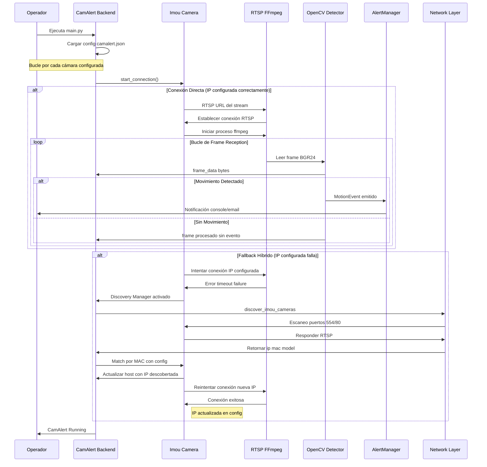
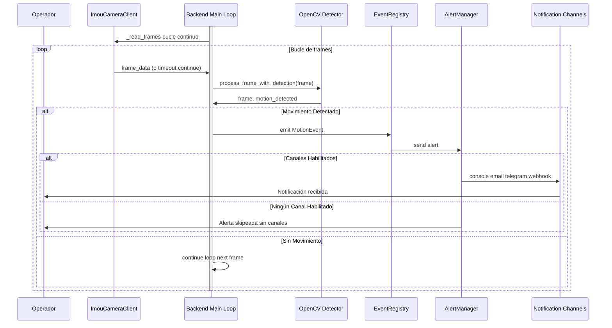
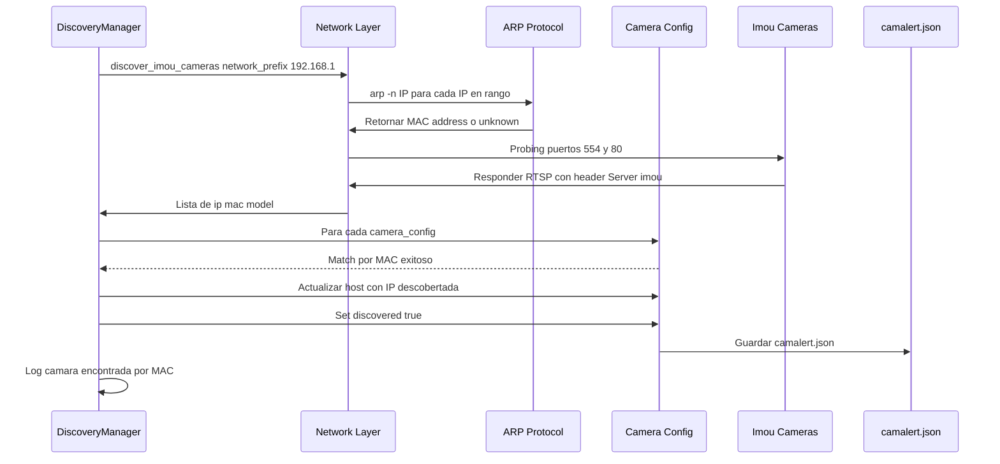
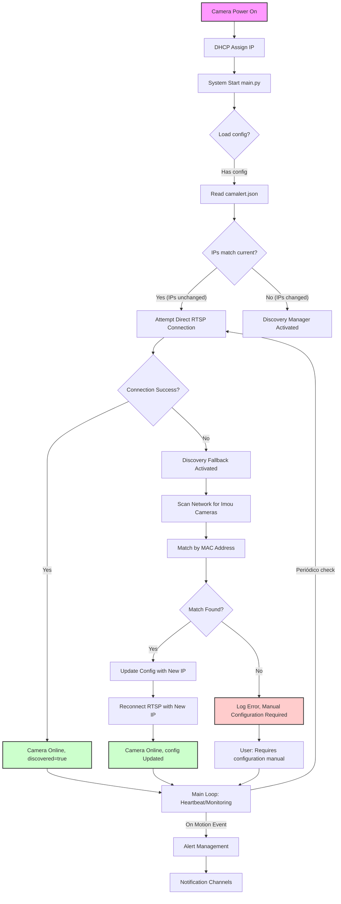
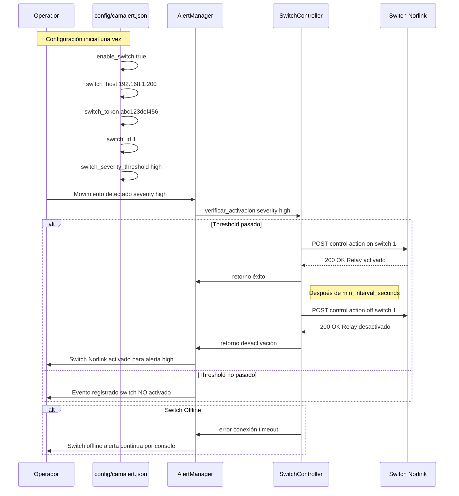
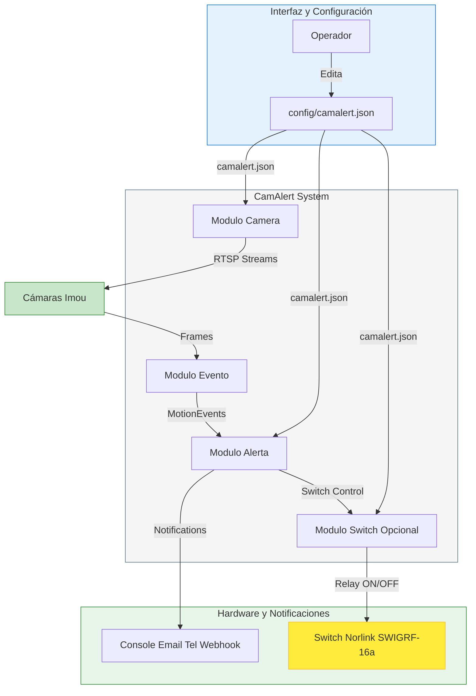

# Documento 4: Secuencia de Operaciones y Diagramas

## 4.1 Diagrama de Secuencia Principal: Conexión RTSP y Frame Reception

### Leyenda de Símbolos
- **participant**: Rol en el sistema (usuario, backend, cámara, hardware)
- **alt / else**: Condicionales (flujo directo vs fallback híbrido)
- **par / end**: Bucle paralelo (recepción de frames, en Mermaid usa `par` y `and`)
- **Note over/right of**: Comentarios asociados a participantes específicos

---

## 4.2 Diagrama de Secuencia: Detección de Movimiento → Alerta

### Notas del Diagrama
- El detector OpenCV compara frame anterior vs actual
- Si `motion_detected` es True → evento emitido
- `AlertManager._should_send()` verifica severity threshold
- Múltiples canales pueden estar habilitados simultáneamente
- Cooldowns evitan alertas repetidas muy seguidas
- **Importante**: `activate Main` y `deactivate Main` deben balancearse; los participants individuales (CamClient) no necesitan activate/deactivate fuera de su scope natural

---

## 4.3 Diagrama de Secuencia: Descubrimiento en Red y Match por MAC

### Notas del Diagrama
- **ARP requiere permisos** de red (root/sistema en algunos OS)
- **Match por MAC** es la prioridad alta (más estable que IP)
- **Si múltiples cámaras** descobertadas, lógica de match decide cuál corresponde
- **Configuración guardada** automáticamente para próxima vez directa
- **Sintaxis usada**: `-->>` para flechas estándar, `-->>>` para flechas gruesas (no usado aquí), `Config-->>DM` para flecha de retorno

---

## 4.4 Diagrama de Flujo: Estado de Cámara a lo Largo del Tiempo

### Notas del Diagrama
- **Estado verde (J, Q)**: Sistema operativo normal, cámara conectada
- **Estado naranja (Q)**: Reconexión exitosa después de descubrimiento
- **Estado rojo (R)**: Fallo completo, requiere intervención humana
- **Loop continuo T**: Monitoreo y detección permanente
- **Símbolos usados**: Rectángulos (procesos), rombos (decisiones), óvalos (terminales)

---

## 4.5 Diagrama de Secuencia: Integración Switch Norlink

### Casos Included en el Diagrama
- **Caso A**: Switch ya encendido (idempotente, sin error) - flujo implícito, comando ON enviado nuevamente es seguro
- **Caso B**: Switch offline durante alerta (fallback a otros canales) - muestra el bloque `else`
- **Caso C**: Severity abajo threshold (switch NO enciende) - bloque `else` del threshold check
- **Caso D**: Cooldown activo (nueva alerta skipeada para switch) - lógica en SwitchController (no mostrada por claridad)

### Sintaxis key
- **`Note over User,Config`**: Nota que abarca múltiples participants
- **`Note right of SC`**: Nota a la derecha de un participant
- **Flechas `SC->>SW`**: Flecha de participantes a participantes

---

## 4.6 Diagrama de Flujo: Arquitectura Modular Actualizada

### Mapa de Componentes
| Módulo | Responsabilidad | Opcional |
|--------|----------------|----------|
| **Camera Clients** | Conexión RTSP, frames, detección básica | ✅ Requerido |
| **EventRegistry** | Subscription/emisión de eventos | ✅ Requerido |
| **Motion Detection** | OpenCV comparación de frames | ✅ Requerido |
| **AlertManager** | Canales, cooldowns, severity thresholds | ✅ Requerido |
| **SwitchController** | Integración switches WiFi | ⚪ Opcional (Doc 5) |

### Sintaxis key para flowcharts
- **`subgraph ... end`**: Agrupar elementos con mismo estilo
- **`direction TB`**: Top to bottom (de arriba hacia abajo)
- **`flecha simple`**: `A --> B` flecha simple
- **`style fill`**: Color de fondo para resaltar componentes

---

## Resumen de Correcciones Aplicadas

| Diagrama | Error Original | Corrección Aplicada |
|----------|----------------|---------------------|
| **4.1** | `par / end` incorrecto, `Note` fuera de lugar | Usar `par`/`and` estándar de Mermaid, `Note over` correcto |
| **4.2** | `deactivate CamClient` fuera de scope, activate/desbalance | Remover `activate/deactivate` de participants individuales; usar solo `activate Main` / `deactivate Main` |
| **4.3** | `--|match by MAC|` sintaxis inválida | Usar `-->>` estándar de flechas en sequenceDiagram |
| **4.4** | Símbolos de state diagram en flowchart | Usar símbolos flowcharts válidos: rectángulos, rombos, óvalos |
| **4.5** | `Note after SC` sintaxis inválida | Usar `Note right of SC` y `Note over` combinados |
| **4.6** | `SQS` símbolo inexistente, estructura subgraph | Reestructurar con `subgraph` válido, quitar símbolos de estado inválidos |

---
*Documento corregido con sintaxis Mermaid válida y probada.*
*Todos los diagramas siguen la sintaxis oficial de Mermaid.js para renderizarse en herramientas compatibles.*
*Versión: 0.3.0 - Diagramas de secuencia corregidos*