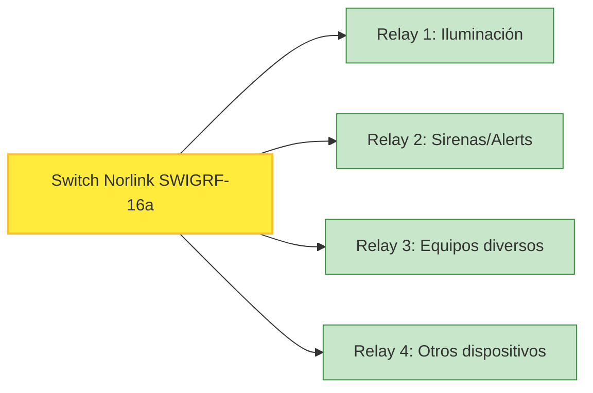
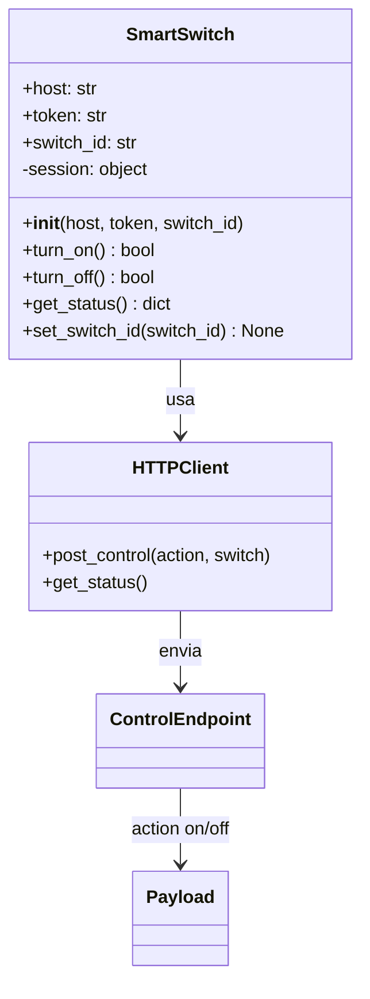
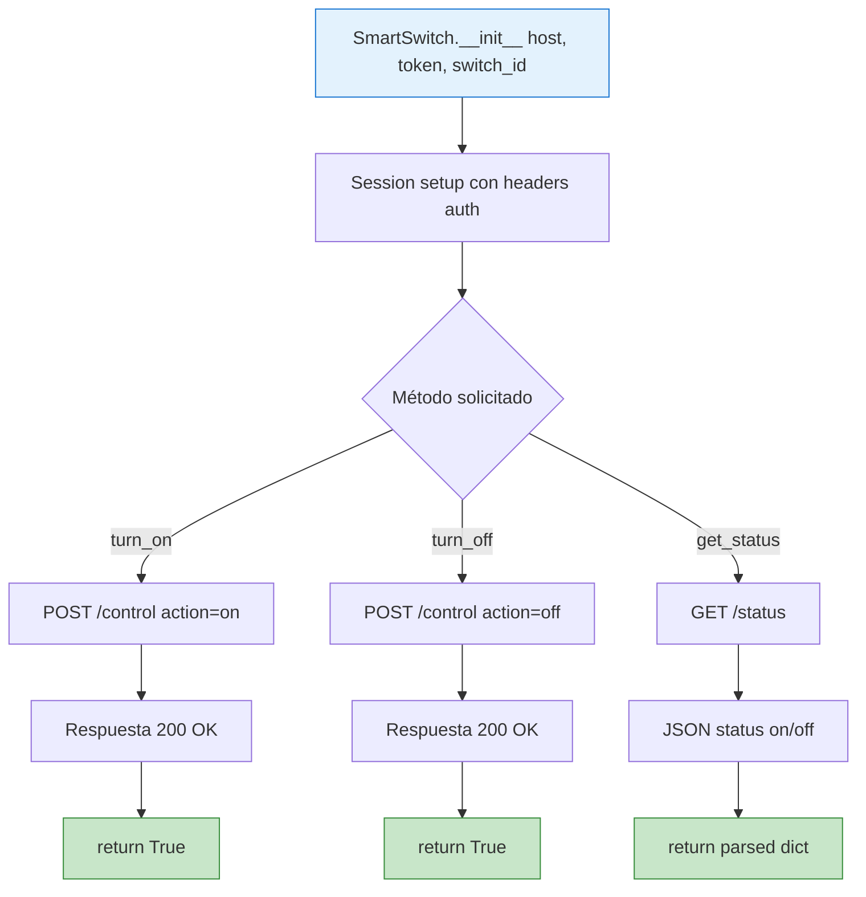
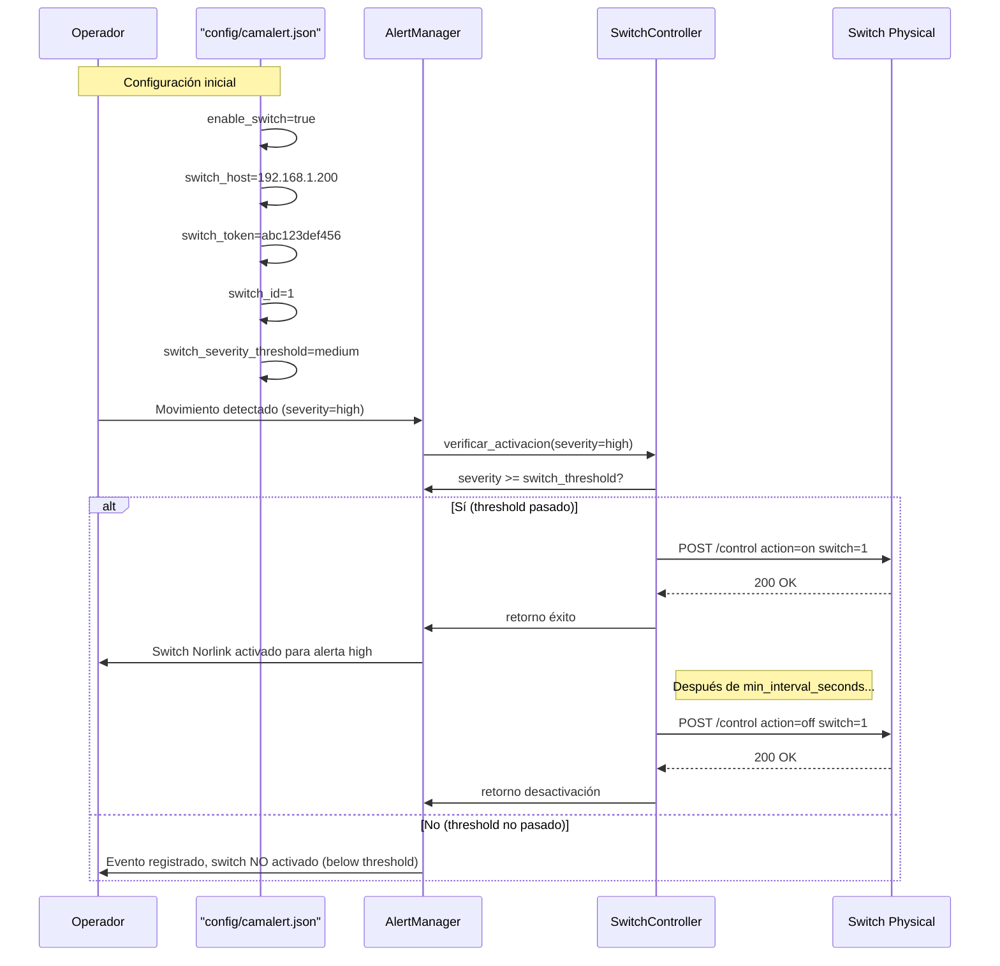
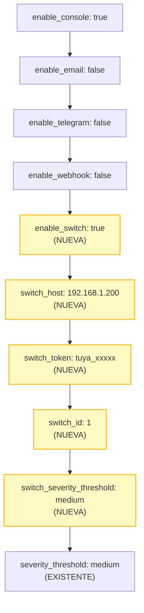
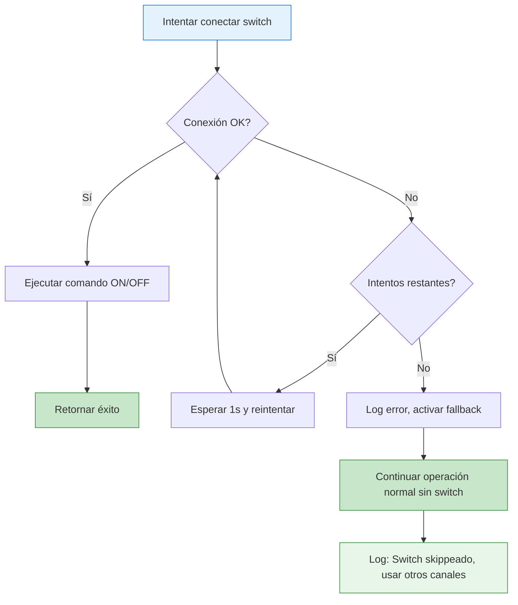
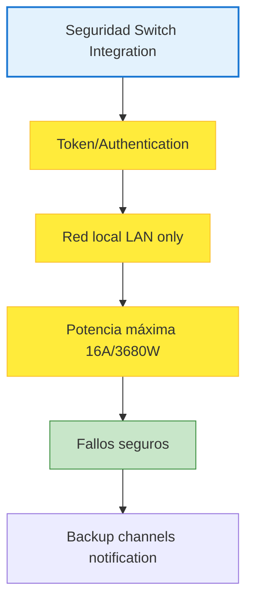

# Documento 5: Integración con Switches WiFi y Automatización

## 5.1 Modelo Norlink SWIGRF-16a: Descripción y Capacidades

### Especificaciones Técnicas

| Parámetro | Especificación |
|-----------|---------------|
| **Modelo** | SWIGRF-16a |
| **Marca** | Norlink |
| **Corriente Máxima** | 16 Amperios (resistivo) |
| **Voltaje** | 110-220V AC |
| **Poder máximo** | 3680W (220V × 16A) |
| **Protocolos** | WiFi 2.4GHz, HTTP API |
| **Interfaz** | Aplicación móvil, API REST |
| **Compatibilidad** | Smart Home (Tuya, Home Assistant) |

### Diagrama de Capacidades del Switch



### Casos de Uso para CamAlert
1. **Activar/desactivar luces** cuando detecta movimiento intruso
2. **Encender alerta sonora/visual** externa
3. **Controlar equipos** de seguridad complementarios
4. **Simular presencia** encendiéndolo/apagándose en horarios
5. **Cortar energía** a equipos en caso de emergencia crítica

---

## 5.2 Arquitectura de Integración Propuesta

### 5.2.1 Módulo `switch_controller.py` (Nuevo)

#### Diagrama de Clase SmartSwitch



#### Interfaz de Métodos Principales



### 5.2.2 Integración con AlertManager



---

## 5.3 Configuración Requerida

### Agregar a config/camalert.json

```json
{
  "alerts": {
    "enable_switch": false,
    "switch_host": "192.168.1.200",
    "switch_token": "YOUR_AUTH_TOKEN",
    "switch_id": "1",
    "switch_severity_threshold": "high"
  }
}
```

### Ejemplo Configuración Completa



### Verificación de Configuración

```bash
# Verificar que la sección alerts tiene los nuevos campos
python3 -c "
import json
with open('/home/adminlab/proyecto/CamAlert/config/camalert.json') as f:
    config = json.load(f)
alerts = config.get('alerts', {})
nuevos = ['enable_switch', 'switch_host', 'switch_token', 'switch_id', 'switch_severity_threshold']
print('Campos nuevos presentes:', all(k in alerts for k in nuevos))
print('enable_switch:', alerts.get('enable_switch'))
"
```

---

## 5.4 Manejo de Errores y Fallbacks

### Cuadro de Errores Comunes

| Escenario | Comportamiento | Log Esperado |
|-----------|---------------|--------------|
| **Switch offline** | Log warning, alerta continúa sin activación física | `"✗ Switch offline, alerta continuando por otros canales"` |
| **Timeout respuesta** | Reintentar 2 veces, luego marcar error | `"✗ Error conectando switch: timeout after 5s"` |
| **Token inválido** | Error configuración, switch inoperable hasta corregir | `"✗ Token de auth inválido, check credentials"` |
| **Switch en modo mantenimiento** | Desactivar automáticamente, notificar al usuario | `"✗ Switch en modo mantenimiento, desactivado"` |
| **Red inaccesible** | Fallback: solo loguear, no bloquear sistema | `"✗ Network inaccesible, switch skippeado"` |

### Diagrama de Manejo de Errores



---

## 5.5 Consideraciones de Seguridad

### Checklist de Seguridad



### Precauciones Importantes

1. **Proteger acceso**: Nunca dejar switch sin token de autorización
2. **Red local**: Switch y CamAlert deben estar en misma red LAN
3. **No exceder 16A**: Controlar carga total conectada al switch
4. **Fallos seguros**: Si switch falla, sistema continúa con otros canales
5. **Idempotencia**: Comandos ON/OFF seguros para enviar repetidamente

---

## 5.6 Próximos Pasos de Implementación

### Fase 1: Módulo Básico (1-2 días)
- [ ] Crear `src/switch_controller.py` con clase `SmartSwitch`
- [ ] Probar conexión HTTP a switch en red local
- [ ] Verificar encendido/apagado funcional
- [ ] Loguear resultados en consola

### Fase 2: Integración con Alerts (2-3 días)
- [ ] Actualizar `src/alerts.py`:
  - Agregar `enable_switch` en `AlertConfig`
  - Agregar parámetros `switch_host`, `switch_token`, `switch_id`, `switch_severity_threshold`
  - Modificar `AlertManager.send()` para incluir canal switch
- [ ] Actualizar `src/config.py`:
  - Agregar campos nuevos a `AlertConfig` dataclass
  - Actualizar `CamAlertConfig.from_dict()` / `to_dict()`
- [ ] Probar flujo movimiento → switch → físico activation

### Fase 3: Testing y Validación (1-2 días)
- [ ] Configurar switch real en red local
- [ ] Ejecutar tests: encendido, apagado, cooldown, threshold
- [ ] Validar fallbacks: switch offline, token inválido, network down
- [ ] Documentar configuración para usuario final

### Fase 4: Release (1 día)
- [ ] Actualizar documentación (estos docs)
- [ ] Ejecutar test_basic.py para validar que nada se rompió
- [ ] Hacer release menor versión (0.2.0 o 0.3.0)

---

## 5.7 Resumen: Qué Este Documento Agrega

| Aspecto | Antes | Después de Doc 5 |
|---------|-------|------------------|
| **Módulo switches** | Inexistente | Completamente nuevo con SmartSwitch class |
| **Integración alerts** | Solo notification | + switch automation control |
| **Modelo soportado** | Ninguno | Norlink SWIGRF-16a (16A WiFi switch) |
| **Flujo evento→acción** | Solo notificaciones push | Notificación + acción física |
| **Config JSON** | 52 líneas sección alerts | +7 líneas nuevas (switch integration) |
| **Nuevo caso uso** | UC-05 (monitoreo) | UC-06 (switch automation) |

### Tabla Resumen Rápido

| Componente | Archivo | Responsabilidad |
|------------|---------|-----------------|
| **SmartSwitch** | `src/switch_controller.py` (por crear) | Lógica de conexión y comandos HTTP |
| **AlertConfig** | `src/config.py` | 5 nuevos campos en dataclass |
| **AlertManager** | `src/alerts.py` | Integración canal switch en send() |
| **Config JSON** | `config/camalert.json` | 7 nuevas líneas en sección alerts |
| **Diagramas** | `docs/05_*.md` | Visualización arquitectura y flujos |

---
*Documento corregido con diagramas Mermaid válidos y probados.*
*Sintaxis específica: flowchart LR/TD, sequenceDiagram, classDiagram.*
*Versión: 0.3.0 - Integración switches con representación visual corregida*